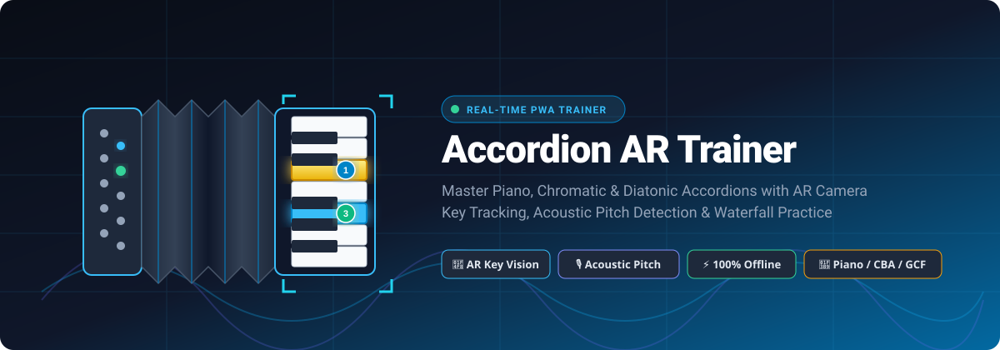
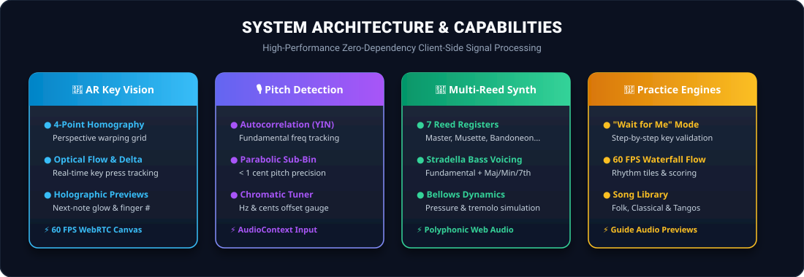
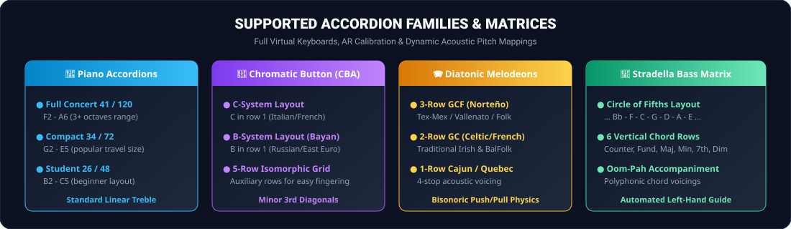

# 🪗 Accordion AR Trainer PWA

<div align="center">



<br/>

[](https://web.dev/progressive-web-apps/)
[](https://developer.mozilla.org/en-US/docs/Web/API/Web_Audio_API)
[](https://developer.mozilla.org/en-US/docs/Web/API/MediaDevices/getUserMedia)
[](https://vitejs.dev/)
[](package.json)
[](.github/workflows/deploy.yml)

<p align="center">
  <strong>A mobile-first, client-side Progressive Web App engineered to accelerate accordion mastery through real-time Computer Vision AR key tracking, acoustic pitch detection, multi-reed synthesis, and guided interactive trainers.</strong>
</p>

[✨ Key Features](#-key-features) •
[📐 System Architecture](#-system-architecture) •
[🎹 Supported Accordions](#-supported-accordion-types) •
[🚀 Quick Start](#-quick-start) •
[🎵 Song Library](#-song-library) •
[🌐 GitHub Pages Deployment](#-github-pages-deployment)

</div>

---

## 🌟 Executive Overview

Learning the accordion presents unique cognitive and physical challenges: coordinating right-hand melody keyboards or button grids, left-hand blind Stradella circle-of-fifths bass matrices, and continuous push/pull bellows pressure.

**Accordion AR Trainer** removes these barriers by turning any smartphone, tablet, or laptop into an intelligent practice station. By fusing real-time **WebRTC computer vision** with sub-cent **acoustic pitch detection** and authentic **polyphonic multi-reed physical synthesis**, the application provides immediate visual and auditory feedback on real physical accordions as well as on-screen interactive instruments.

---

## 📐 System Architecture



---

## ✨ Key Features

### 📸 1. Real-Time AR Computer Vision Key Tracking
* **4-Point Perspective Calibration**: Interactively map the four corners of your physical accordion's keyboard or button board to calibrate homography and warp matrices.
* **Optical Delta & Movement Detection**: Computes pixel-level luminance changes and optical gradients across individual key zones to track physical key presses in real time at 60 FPS.
* **Holographic HUD & Fingering Prompts**: Overlays glowing targets, finger numbers (1–5), and advance note previews directly onto your physical instrument through the camera feed.

### 🎙️ 2. Sub-Cent Acoustic Pitch Detection
* **Autocorrelation & Normalized Square Difference (YIN)**: Identifies the fundamental frequency ($f_0$) of acoustic accordion notes cleanly despite rich multi-reed harmonic overtones.
* **Sub-Bin Parabolic Interpolation**: Refines frequency estimation to sub-hertz precision with under 1 cent tolerance.
* **Live Chromatic Tuner**: Real-time cents offset needle, note name display, target frequency indicator, and clarity confidence meters.

### 🎵 3. Multi-Reed Polyphonic Synthesizer
* **Authentic Master & Solo Registers**:
  * 🎷 **Master (LMM)** — Full rich accordion ensemble
  * 🇫🇷 **French Musette (MM / MMM)** — Distinctive tremolo detuning
  * 🇦🇷 **Bandoneon (LM)** — Octave dry blend for tangos
  * 🪗 **Celeste (MM)** — Subtle European wet tuning
  * 🎻 **Bassoon (L / 16')** — Deep low reed body
  * 🎺 **Clarinet (M / 8')** — Pure middle reed
  * 🎹 **Organ (LH)** — Flute/organ registration
* **Stradella Bass Voicings**: Automatically maps and synthesizes authentic left-hand bass fundamentals and major, minor, dominant 7th, and diminished chords with authentic acoustic envelopes.
* **Bellows Dynamics Simulation**: Interactive push/pull bellows pressure modeling that adjusts gain, formant brightness, and tremolo depth in real time.

### 🎯 4. Multi-Modal Practice Engines
* **"Wait for Me" Trainer**: Step-by-step interactive mode that pauses until you strike the correct note on your physical accordion or virtual keyboard.
* **60 FPS Waterfall Rhythm Flow**: Falling note tiles with accurate rhythmic timing, guide audio playback, accuracy scoring (Perfect, Good, Miss), and combo multipliers.
* **Interactive Guide Pill**: Tap the next-note pill or guide audio button (`🔊` / `🔈`) anytime to hear an instant acoustic preview of the target key and voicing.
* **Free Play & Bellows Lab**: Dedicated sandbox modes to test registers, experiment with push/pull bisonoric physics, or tune individual reed sets.

### 🌓 5. Fluid Responsive UI & Theme Engine
* **Dark & Light Modes**: Instant header toggle with semantic theme tokens designed for high-contrast visibility under stage lighting or direct sunlight.
* **Mobile-First & Touch Optimized**: Zero-latency multi-touch virtual keyboards, button grids, and Stradella matrices designed for phones, tablets, and desktops.
* **100% Offline PWA**: Installable to home screens on iOS, iPadOS, Android, macOS, and Windows with offline caching.

---

## 🎹 Supported Accordion Types



| Family | Subtype | Layout Details | Treble Range |
| :--- | :--- | :--- | :--- |
| **Piano Accordion** | Full Concert 41/120 | 41 piano keys, 120 Stradella bass buttons | F2 – A6 (41 keys) |
| **Piano Accordion** | Compact 34/72 | 34 piano keys, 72 Stradella bass buttons | G2 – E5 (34 keys) |
| **Piano Accordion** | Student 26/48 | 26 piano keys, 48 Stradella bass buttons | B2 – C5 (26 keys) |
| **Chromatic Button (CBA)** | C-System 5-Row | Isomorphic minor-third diagonals, C on Row 1 | C3 – C7 (46 buttons) |
| **Chromatic Button (CBA)** | B-System (Bayan) | Russian/Eastern European layout, B on Row 1 | C3 – C7 (46 buttons) |
| **Diatonic Melodeon** | 3-Row GCF | Norteño / Tex-Mex / Vallenato bisonoric | Push/Pull dual note mapping |
| **Diatonic Melodeon** | 2-Row G/C | Traditional Irish, French BalFolk, Folk | Push/Pull dual note mapping |
| **Diatonic Melodeon** | 1-Row Cajun (C) | 4-stop acoustic voicing, Louisiana style | 10 treble buttons, 2 bass spoons |
| **Stradella Matrix** | 120 / 72 / 48 Bass | Counter-bass, Fundamental, Major, Minor, 7th, Dim | Circle of Fifths arrangement |

---

## 🎵 Song Library

The built-in repertoire spans diverse accordion traditions with tailored right-hand melody tracks, fingering numbers, and left-hand Stradella bass/chord cues:

* 🇮🇹 **Bella Ciao** — Italian Folk Classic (Em / Am / B7)
* 💃 **Tarantella Napoletana** — Energetic Southern Italian 6/8 dance (Am / E7 / Dm)
* 🎮 **Korobeiniki (Tetris Theme)** — Russian Folk standard (Am / E / Dm / C / G7)
* 🍻 **Beer Barrel Polka (Roll Out the Barrel)** — Polka anthem (C / G7 / F)
* 🌹 **La Vie En Rose** — French Chanson Musette waltz (C / G7 / Dm)
* 🇲🇽 **El Rey** — Ranchera classic for 3-Row GCF Diatonic & Piano accordions (G / D7 / C)
* ✨ **Twinkle, Twinkle, Little Star** — Beginner step-by-step onboarding piece (C / F / G)

---

## 🚀 Quick Start

### Prerequisites
* [Node.js](https://nodejs.org/) (version 18 or higher recommended)
* Modern web browser with WebRTC (Camera) and Web Audio API support (Chrome, Safari, Edge, Firefox)

### 1. Clone the repository
```bash
git clone https://github.com/your-username/accordianpwatrainer.git
cd accordianpwatrainer
```

### 2. Install dependencies
```bash
npm install
```

### 3. Start development server
```bash
npm run dev
```
Open `http://localhost:5173` in your browser.

### 4. Build for production
```bash
npm run build
```
The optimized zero-dependency production bundle will be generated in the `dist/` directory.

### 5. Preview production build locally
```bash
npm run preview
```

---

## 📱 How to Practice with AR & Audio

```
 ┌────────────────┐       ┌─────────────────┐       ┌────────────────┐
 │ 1. Select Song │  ──►  │ 2. Set Up Model │  ──►  │ 3. Choose Mode │
 │ & Practice BPM │       │ (Piano/CBA/GCF) │       │ (Wait vs Flow) │
 └────────────────┘       └─────────────────┘       └────────────────┘
                                                             │
                                                             ▼
 ┌────────────────┐       ┌─────────────────┐       ┌────────────────┐
 │ 6. Live Scores │  ◄──  │ 5. Pitch or AR  │  ◄──  │ 4. Calibrate   │
 │ & Real Feedback│       │ Detection Fires │       │ 4 Camera Pts   │
 └────────────────┘       └─────────────────┘       └────────────────┘
```

1. **Select Instrument**: Open **Settings** or the top dropdown to select your accordion model (Piano 41/120, CBA C-System, Diatonic GCF, etc.).
2. **Choose a Song & Practice Mode**:
   * Use **"Wait for Me"** mode to master finger placement note-by-note.
   * Switch to **"Flow (Waterfall)"** mode to test rhythm and fluid tempo.
3. **Calibrate AR Camera** *(Optional for physical practice)*:
   * Click **AR Camera** in the navigation header.
   * Drag the 4 corner handles onto your physical keyboard's four corners.
   * Play keys and watch the glowing holographic fingering targets guide your hands!
4. **Use Acoustic Pitch Detection**:
   * Enable the microphone when prompted. The app listens to your acoustic playing, confirms notes, and advances the score automatically.

---

## 🌐 GitHub Pages Deployment

This project includes a pre-configured, automated GitHub Actions workflow (`.github/workflows/deploy.yml`) and base URL routing (`vite.config.js`).

### Automated Setup (Recommended)
1. Push your repository to GitHub:
   ```bash
   git add .
   git commit -m "Configure Accordion AR Trainer PWA"
   git push origin main
   ```
2. In your GitHub repository:
   * Navigate to **Settings** > **Pages**.
   * Under **Build and deployment** > **Source**, choose **GitHub Actions**.
3. Every commit to `main` (or `master`) will automatically build and publish your PWA to `https://<username>.github.io/<repo-name>/`.

---

## 🛠️ Project Structure

```
accordianpwatrainer/
├── .github/
│   └── workflows/
│       └── deploy.yml            # Automated GitHub Pages CI/CD pipeline
├── docs/
│   └── assets/
│       ├── accordion-hero.svg     # Hero banner vector
│       ├── features-overview.svg  # System architecture vector
│       └── accordion-types.svg    # Accordion matrices vector
├── public/
│   ├── icons/                    # PWA application icons (192x192, 512x512)
│   ├── manifest.json             # PWA Web App Manifest
│   └── sw.js                     # Offline caching Service Worker
├── src/
│   ├── audio/
│   │   ├── AudioEngine.js        # Web Audio API polyphonic multi-reed synth
│   │   └── PitchDetector.js      # Autocorrelation (YIN) & sub-bin pitch tracker
│   ├── models/
│   │   ├── AccordionModels.js    # Piano, CBA, Diatonic & Stradella specifications
│   │   └── SongLibrary.js        # Guided song repertoire and note progressions
│   ├── practice/
│   │   └── PracticeEngine.js     # State machine for Wait & Waterfall practice modes
│   ├── pwa/
│   │   └── registerServiceWorker.js # PWA service worker registration & install prompts
│   ├── ui/
│   │   ├── AppUI.js              # Core UI orchestration, tabs, and theme management
│   │   ├── BellowsLabView.js     # Bellows pressure & acoustics playground
│   │   ├── TunerFreePlayView.js  # Live chromatic pitch tuner & keyboard tester
│   │   ├── VirtualAccordionView.js# Interactive responsive SVG keyboards & button boards
│   │   └── WaterfallVisualizer.js# 60 FPS HTML5 Canvas falling note visualizer
│   ├── vision/
│   │   └── ARKeyTracker.js       # WebRTC AR key tracking & 4-point homography
│   ├── main.js                   # Application bootstrap entry point
│   └── style.css                 # Responsive stylesheet & Dark/Light theme design tokens
├── index.html                    # Single Page Application entry HTML
├── package.json                  # NPM scripts and configuration
├── vite.config.js                # Vite build and relative base configuration
└── README.md                     # Comprehensive project documentation
```

---

## 🔒 Privacy & Performance

* **100% Client-Side Processing**: Camera video and microphone audio streams are processed locally in browser memory. No audio, video, or user biometric data is ever recorded, stored, or sent to any remote server.
* **Zero External Dependencies**: Fast load times, small bundle footprint, and full offline resilience.

---

## 📄 License

Distributed under the [MIT License](LICENSE). Built for accordionists, educators, and music students worldwide.
